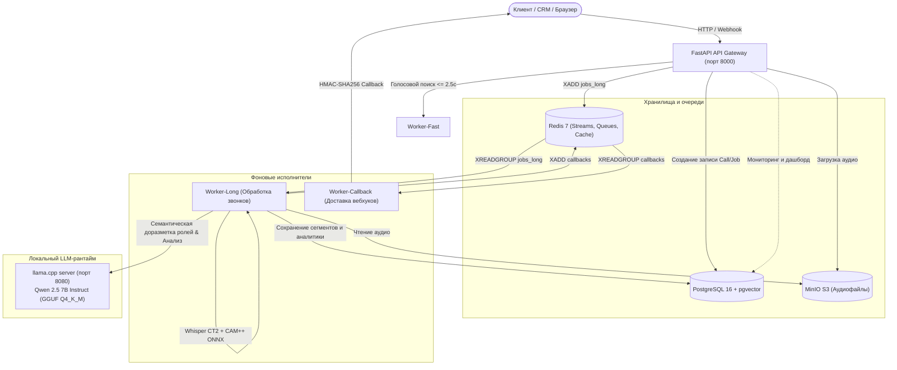

# Платформа речевой аналитики и голосового поиска (`apc-speech`)

Автономный промышленный сервис локального распознавания русской речи, интеллектуальной диаризации, семантического анализа телефонных звонков и ультра-быстрого голосового поиска для сферы наружной рекламы (Outdoor Advertising).

Сервис спроектирован для работы **в закрытом контуре (On-Premise / Private Cloud)** без передачи звуковых и текстовых данных во внешние публичные облака.

---

## Оглавление

1. [Архитектура системы](#архитектура-системы)
2. [Профили запуска (`small` vs `local-full`)](#профили-запуска-small-vs-local-full)
3. [Полный пайплайн обработки звонка](#полный-пайплайн-обработки-звонка)
4. [Алгоритмы и модели](#алгоритмы-и-модели)
   * [Распознавание речи (ASR)](#распознавание-речи-asr)
   * [Акустическая диаризация (CAM++ + Якоря + HMM Витерби)](#акустическая-диаризация-cam--якоря--hmm-витерби)
   * [Семантическая доразметка ролей через LLM](#семантическая-доразметка-ролей-через-llm)
   * [Детерминированные речевые метрики](#детерминированные-речевые-метрики)
   * [Маскирование персональных данных (PII)](#маскирование-персональных-данных-pii)
   * [Смысловой анализ и контроль качества (LLM)](#смысловой-анализ-и-контроль-качества-llm)
5. [Возможные недостатки и краевые случаи (Known Limitations)](#возможные-недостатки-и-краевые-случаи-known-limitations)
6. [Быстрый старт и развертывание](#быстрый-старт-и-развертывание)
7. [Контракт API и примеры вызовов](#контракт-api-и-примеры-вызовов)
8. [Интеграции с CRM (Битрикс24, amoCRM)](#интеграции-с-crm-битрикс24-amocrm)
9. [Веб-дашборд](#веб-дашборд)
10. [Структура репозитория](#структура-репозитория)
11. [Тестирование и контроль качества](#тестирование-и-контроль-качества)

---

## Архитектура системы

Сервис реализован по архитектуре **модульного монолита с выделенными фоновыми воркерами (Modular Monolith with Dedicated Workers)**:



### Основные компоненты комплекса:

1. **`api` (FastAPI / Uvicorn)**:
   * REST API endpoints, валидация входящих запросов, проверка токенов (Bearer / Dev-Token).
   * Защита от SSRF при скачивании аудио по URL (блокировка loopback, RFC1918, link-local, облачных metadata-сервисов).
   * Раздача веб-дашборда с интерактивным аудиоплеером и караоке-таймкодами.
   * Health/Readiness пробы (`/health`, `/ready`).
2. **`worker-long` (Python Async Worker)**:
   * Читает очередь `jobs_long` через Redis Streams (с поддержкой Consumer Groups и восстановления зависших задач через Pending Entries List).
   * Выполняет полный конвейер: чанкинг, ASR (Whisper), CAM++ диаризацию, марковское сглаживание, LLM-доразметку ролей, расчет акустических метрик, PII-маскирование и генерацию структурированного JSON-анализа.
3. **`worker-fast` (Python Async Worker)**:
   * Выполняет сверхбыструю микро-транскрипцию коротких голосовых запросов ($\le 60$ с) для голосового поиска прямо в оперативной памяти без записи промежуточных файлов на диск ($t \le 2.5$ с).
4. **`worker-callback` (Python Async Worker)**:
   * Гарантированная доставка вебхуков с результатами анализа в вызывающие системы с расчетом HMAC-SHA256 подписи в заголовке `X-Signature-SHA256` и экспоненциальным backoff (до 5 попыток).
5. **`llm-runtime` (llama.cpp server)**:
   * Контейнер на базе `ghcr.io/ggml-org/llama.cpp:server`.
   * Обслуживает локальную квантованную модель `Qwen 2.5 7B Instruct` (`qwen2.5-7b-instruct-q4_k_m.gguf`, 4.4 ГБ).
   * Предоставляет OpenAI-совместимый эндпоинт `/v1/chat/completions` со строгим форсированием JSON-схем (`json_schema`).
6. **`postgres` (PostgreSQL 16 + pgvector)**:
   * Хранит звонки (`calls`), задачи (`jobs`), порепличные сегменты (`transcript_segments`), структурированные анализы (`analyses`), историю вебхуков (`callback_logs`) и эмбеддинги фраз (`embeddings`).
7. **`redis` (Redis 7 Alpine)**:
   * Персистентные потоки задач Redis Streams, rate limiting (Sliding Window), кэширование токенов.
8. **`minio` (S3-совместимое объектное хранилище)**:
   * Хранение исходных и обработанных аудиозаписей с presigned URL доступом и поддержкой жизненного цикла (retention policy).

---

## Профили запуска (`small` vs `local-full`)

Система поддерживает два режима развертывания, переключаемых переменной `APP_PROFILE` в файле [`.env`](.env):

| Параметр | Профиль `small` (по умолчанию) | Профиль `local-full` |
| :--- | :--- | :--- |
| **Целевое железо** | Слабые CPU-серверы (2–4 vCPU, 4 ГБ RAM) | Серверы с запасом CPU или GPU (4–8 vCPU, 8–16 ГБ RAM) |
| **Контейнер LLM** | Не запускается (0 МБ ОЗУ) | Запущен `llm-runtime` (занимает ~3.3–4.0 ГБ ОЗУ) |
| **Распознавание речи** | `faster-whisper` (int8 на CPU) | `faster-whisper` (int8 на CPU) |
| **Акустическая диаризация** | CAM++ ONNX + Якоря + HMM Витерби | CAM++ ONNX + Якоря + HMM Витерби |
| **Семантическая доразметка ролей** | Регулярные выражения и эвристики | **Qwen 2.5 7B** (семантическая проверка реплик) |
| **Анализ звонка и чек-лист** | Детерминированный rule-based анализатор | **Qwen 2.5 7B** (глубокий анализ по JSON-схеме) |
| **Саммари звонка** | Шаблонное резюме по ключевым словам | Живой человекочитаемый смысловой пересказ |
| **Запуск** | `docker compose up -d` | `docker compose --profile local-full up -d` |

---

## Полный пайплайн обработки звонка

Каждая аудиозапись, поступающая в `worker-long`, последовательно проходит следующие этапы:

```
[Аудиозапись (MP3/WAV/OGG/AAC)]
            │
            ▼ (Шаг 1: Препроцессинг)
  FFmpeg 16kHz 16-bit PCM + Проверка изоляции каналов
   ├── Если Stereo и каналы изолированы -> Стерео-сплит (ch0=manager, ch1=client)
   └── Если Mono или Dual-Mono -> Моно-пайплайн
            │
            ▼ (Шаг 2: Адаптивный чанкинг & VAD)
  Silero VAD v5 находит естественные паузы тишины (длина чанков 60-180с)
            │
            ▼ (Шаг 3: ASR Распознавание речи)
  faster-whisper (CTranslate2 int8) -> Слова с таймкодами + ITN нормализация
            │
            ▼ (Шаг 4: Акустическая диаризация)
  split_segment_into_turns -> CAM++ ONNX (192-dim) -> Якорная кластеризация -> HMM Витерби
            │
            ▼ (Шаг 5: Семантическая доразметка ролей)
   ├── В профиле local-full: Запрос в Qwen 2.5 7B (исправление перепутанных ролей)
   └── В профиле small: Регулярные выражения и речевые паттерны
            │
            ▼ (Шаг 6: Речевые метрики)
  Расчет пауз, перебиваний, долей речи, WPM менеджера и клиента (чистая математика)
            │
            ▼ (Шаг 7: PII-маскирование и сохранение в БД)
  Regex + Natasha NER скрывают телефоны, email, карты, паспорта -> Запись в PostgreSQL
            │
            ▼ (Шаг 8: Смысловой бизнес-анализ)
   ├── В профиле local-full: Qwen 2.5 7B генерирует JSON-анализ, чек-лист, договоренности
   └── В профиле small: Rule-based анализатор (taxonomy.yaml, checklist.yaml)
            │
            ▼ (Шаг 9: Доставка вебхуков)
  Worker-Callback отправляет HMAC-подписанный JSON в CRM (Битрикс24 / amoCRM)
```

---

## Алгоритмы и модели

### Распознавание речи (ASR)
* **Движок**: `faster-whisper` на базе оптимизированного C++ рантайма **CTranslate2**.
* **Модели**:
  * Основная: `./models/whisper-podlodka-turbo-ct2` (адаптированная русскоязычная Turbo-модель).
  * Поддерживаются стандартные веса: `small`, `base`, `large-v3`.
* **Квантование**: `int8` на CPU, обеспечивающее скорость транскрипции в 3–5 раз быстрее реального времени на обычных серверных ядрах без GPU.
* **Таймкоды слов**: флаг `word_timestamps=True` извлекает точные временные границы каждого слова для разделения реплик и подсчета темпа речи.
* **Специализированная нормализация (`RussianTextNormalizer`)**:
  * Преобразует числительные в форматы наружной рекламы («три на шесть» $\rightarrow$ «3×6», «ситиборд два на четыре» $\rightarrow$ «ситиборд 2×4»).
  * Распознает и форматирует денежные суммы («сто пятьдесят тысяч рублей» $\rightarrow$ «150 000 руб.»).
  * Корректирует специфические топонимы (МКАД, ТТК, шоссе, станции метро Москвы и МО).

---

### Акустическая диаризация (CAM++ + Якоря + HMM Витерби)

В модуле [`app/diarization/mono_diarizer.py`](app/diarization/mono_diarizer.py) реализован трехступенчатый акустический алгоритм:

1. **Разбиение сегментов на реплики (`split_segment_into_turns`)**:
   * Whisper часто объединяет в один сегмент фразу менеджера и ответ клиента, если между ними была короткая пауза.
   * Алгоритм анализирует таймкоды соседних слов: если пауза $\ge 0.35$ с или слово оканчивается знаком препинания (`.`, `?`, `!`) при паузе $\ge 0.20$ с, сегмент разделяется на независимые реплики.
2. **Извлечение нейросетевых d-векторов CAM++**:
   * Используется модель **CAM++** (`models/campplus.onnx`, 28 МБ) через `onnxruntime` на CPU.
   * На входе: 80-полосные log Mel-фильтры (fbank), вычисляемые через `librosa`.
   * На выходе: 192-мерный нормализованный вектор акустического отпечатка голоса.
   * Для коротких реплик ($< 0.8$ с) применяется симметричный контекстный паддинг окружающего аудио для исключения артефактов граничных условий.
3. **Якорная кластеризация (`_find_anchor_centroids`)**:
   * Из всех реплик отбираются кандидаты с длительностью $\ge 2.0$ с (чистый голос без шумов междометий).
   * Вычисляется матрица косинусных расстояний $D_{ij} = 1 - \langle \mathbf{x}_i, \mathbf{x}_j \rangle$.
   * Находится пара кандидатов с максимальным расстоянием — голосовые полюса Спикера 0 и Спикера 1.
   * Вокруг них группируются остальные длинные реплики для формирования устойчивых центроидов $C_0$ и $C_1$.
   * Если максимальная дистанция $< 0.08$ (`min_speaker_distance`), звонок классифицируется как **монолог** одного человека (`SPEAKER_0`).
4. **Марковское сглаживание переходов Витерби (`_viterbi_smoothing`)**:
   * Решает проблему «дрожания» спикеров на коротких словах («да», «ага», «алло»).
   * Вычисляется относительная нормализованная маржа сходства:
     $$\Delta s_i = \frac{\langle \mathbf{x}_i, C_0 \rangle - \langle \mathbf{x}_i, C_1 \rangle}{1 - \langle C_0, C_1 \rangle}$$
     Это гарантирует контрастность сигнала (от $-1.0$ до $+1.0$) даже для двух очень похожих мужских или женских голосов.
   * Вероятность смены спикера $P(\text{switch})$ зависит от паузы между репликами:
     * Пауза $< 0.25$ с: $P(\text{switch}) = 0.15$ (человек продолжает свою мысль).
     * Пауза $0.25$–$0.50$ с: $P(\text{switch}) = 0.35$.
     * Пауза $\ge 0.50$ с: $P(\text{switch}) = 0.50$ (естественная диалоговая пауза).
   * Алгоритм динамического программирования Витерби восстанавливает глобально оптимальную последовательность спикеров.

---

### Семантическая доразметка ролей через LLM

В профиле `local-full` в модуле [`app/llm/local_adapter.py`](app/llm/local_adapter.py) подключен метод [`refine_speaker_roles`](app/llm/local_adapter.py#L96-L190):

* Перед сохранением в базу данных список всех реплик отправляется в модель **Qwen 2.5 7B Instruct**.
* Модель оценивает прагматику реплик (вопрос-ответ, предложение условий, презентация компании, запрос счета) и возвращает строгий JSON-массив:
  ```json
  { "roles": ["manager", "client", "manager", "client", ...] }
  ```
* Если акустическая диаризация случайно перепутала спикера на короткой фразе, семантическая модель возвращает ей истинную роль.
* В случае таймаута или ошибки сети система автоматически откатывается на результаты эвристического классификатора без падения задачи.

---

### Детерминированные речевые метрики

Модуль [`app/metrics/speech_metrics.py`](app/metrics/speech_metrics.py) рассчитывает объективные показатели речи **строго детерминированным кодом (без участия нейросетей и без риска галлюцинаций)**:

* **Доли речи (`manager_speech_share`, `client_speech_share`)**: процент чистого времени говорения каждого участника.
* **Количество перебиваний (`interruptions_count`)**: случаи, когда один участник начинает говорить во время речи другого с перекрытием более $0.3$ секунды.
* **Длительность тишины (`silence_duration_sec`)**: суммарное время пауз в разговоре (вычисляется через математическое объединение отрезков активной речи).
* **Темп речи (`manager_wpm`, `client_wpm`)**: скорость говорения в словах в минуту.

---

### Маскирование персональных данных (PII)

Модуль [`app/pii/masker.py`](app/pii/masker.py) гарантирует безопасность хранения клиентских данных:

* Номера телефонов (РФ и международные форматы) $\rightarrow$ `[PHONE_NUMBER]`.
* Адреса электронной почты $\rightarrow$ `[EMAIL]`.
* Номера банковских карт (алгоритм Луна и маски по 16 цифрам) $\rightarrow$ `[BANK_CARD]`.
* Серии и номера паспортов РФ $\rightarrow$ `[PASSPORT]`.
* Маскирование выполняется **до** передачи текста в блок семантического анализа и сохранения в публичные поля транскрипта.

---

### Смысловой анализ и контроль качества (LLM)

В профиле `local-full` LLM заполняет контракт согласно схеме [`schemas/analysis_schema_v1.json`](schemas/analysis_schema_v1.json):

1. **`summary`**: связный пересказ сути разговора до 1000 символов.
2. **`call_result`**: итог (`success_deal`, `follow_up_scheduled`, `info_provided`, `client_declined`, `unclear_spam`).
3. **`inquiry_type`**: тематика (`pricing`, `availability`, `inventory_search`, `complaint` и др.).
4. **`entities`**: извлеченные города, рекламные форматы, объемы, бюджет и планируемые периоды.
5. **`agreements`**: список конкретных обязательств сторон с дедлайнами (`who`, `what`, `deadline`).
6. **`sentiment`**: тональность клиента (`positive`, `neutral`, `negative`, `conflict`) и тон менеджера (`polite_constructive`, `indifferent`, `rude`).
7. **`manager_checklist`**: автоматическая оценка звонка по 5 критериям:
   * Приветствие и представление компании.
   * Выявление потребностей клиента.
   * Предложение вариантов размещения.
   * Озвучивание следующего шага взаимодействия.
   * Фиксация контактов клиента.
   * Поиск запрещенных стоп-слов из `config/checklist.yaml`.
   * Итоговый скоринг менеджера от 0 до 5.

---

## Возможные недостатки и краевые случаи (Known Limitations)

Для обеспечения прозрачности эксплуатации ниже приведены сценарии, в которых математические эвристики или локальная модель могут допускать неточности:

### 1. Экстремально асимметричный диалог в моно-записи
* **Суть**: Менеджер произносит длинные фразы по 10 секунд, а клиент на протяжении всего звонка отвечает исключительно односложно: *«Да»*, *«Алло»*, *«Угу»* (ни одной фразы длительнее $1.5$ с).
* **Следствие**: Алгоритм якорной кластеризации CAM++ отберет в качестве якорей фразы только менеджера. Если вариативность голоса менеджера низкая, акустическая модель может счесть запись монологом и окрасить поддакивания клиента в цвет менеджера.
* **Компенсация**: В профиле `local-full` семантическая доразметка Qwen выправляет подобные реплики по смыслу контекста.

### 2. Быстрые перебивания речи с минимальной паузой (Cross-talk)
* **Суть**: Один собеседник вклинивается со словом *«Подождите»* в микропаузу речи другого собеседника ($< 0.2$ с).
* **Следствие**: Из-за штрафа марковской модели за частые перескоки на коротких интервалах слово *«Подождите»* может быть приписано первому говорящему.

### 3. Резкая смена акустического тракта одним человеком
* **Суть**: Собеседник в процессе звонка переключается с телефонной трубки на громкую связь в автомобиле (появляется реверберация помещения и шум дороги).
* **Следствие**: CAM++ может воспринять изменившийся спектральный окрас одного и того же человека как появление второго спикера.

### 4. Производительность LLM на чистом CPU
* **Суть**: Инференс Qwen 2.5 7B на 4 ядрах CPU через llama.cpp генерирует текст со скоростью ~4.8–5.2 токенов/сек.
* **Следствие**: Полный смысловой анализ 3-минутного звонка занимает около 20–35 секунд (включая проверку ролей). Это полностью штатно для фоновой асинхронной очереди `worker-long`, но не подходит для синхронного realtime-ответа.

### 5. Лимит контекстного окна LLM
* **Суть**: В `docker-compose.yml` размер контекста `llama-server` сконфигурирован флагом `-c 4096`.
* **Следствие**: Звонки длительностью свыше 40 минут с непрерывной речью требуют предварительного сжатия или чанкинга транскрипта перед отправкой в LLM во избежание превышения лимита токенов.

---

## Быстрый старт и развертывание

### Требования к системе
* **ОС**: Linux (Ubuntu 22.04+, Debian 12, Arch Linux, RHEL 9).
* **Docker & Docker Compose**: Docker Engine 24+ с поддержкой Docker Compose v2.
* **Ресурсы**:
  * Профиль `small`: от 2 vCPU, от 4 ГБ RAM, 10 ГБ на диске.
  * Профиль `local-full`: от 4–8 vCPU, от 8–16 ГБ RAM, 20 ГБ на диске.

### 1. Клонирование и настройка окружения
```bash
git clone https://github.com/zetgame123/apc-speech.git
cd apc-speech
cp .env.example .env
```

Отредактируйте `.env`:
* Для базового легковесного режима: `APP_PROFILE=small`
* Для режима с локальной нейросетью Qwen 2.5 7B: `APP_PROFILE=local-full`
* Задайте `DEV_TOKEN=my-secure-token` и `CALLBACK_SIGNING_SECRET`.

### 2. Загрузка моделей
```bash
# Загрузка весов Whisper, CAM++ ONNX и Qwen GGUF
python3 scripts/download_models.py
```
Файлы будут сохранены в каталог `./models/`:
* `models/campplus.onnx` (~28 МБ)
* `models/whisper-podlodka-turbo-ct2/` (~1.6 ГБ)
* `models/qwen2.5-7b-instruct-q4_k_m.gguf` (~4.4 ГБ, для `local-full`)

### 3. Запуск контейнеров

```bash
# Для профиля small (без LLM, 4 ГБ ОЗУ)
docker compose up -d --build

# Для профиля local-full (с Qwen 2.5 7B, 8+ ГБ ОЗУ)
docker compose --profile local-full up -d --build
```

### 4. Проверка состояния
```bash
# Статус всех контейнеров
docker compose --profile local-full ps

# Проверка API и динамического профиля
curl -s http://localhost:8000/health | jq .
```
Ответ:
```json
{
  "status": "healthy",
  "app_profile": "local-full",
  "llm_model": "qwen2.5-7b-instruct",
  "version": "1.0.0"
}
```

---

## Контракт API и примеры вызовов

Все запросы авторизуются через заголовок `Authorization: Bearer <TOKEN>`.

### 1. Загрузка аудиозаписи на обработку (`POST /v1/jobs/upload`)
```bash
curl -X POST "http://localhost:8000/v1/jobs/upload" \
  -H "Authorization: Bearer my-secure-token" \
  -F "namespace=outdoor_msk" \
  -F "file=@sample_call.mp3" \
  -F "external_id=crm_lead_12345" \
  -F "direction=inbound" \
  -F "callback_url=https://crm.company.ru/webhooks/speech"
```
**Ответ `202 Accepted`**:
```json
{
  "job_id": "9b1deb4d-3b7d-4bad-9bdd-2b0d7b3dcb6d",
  "call_id": "c1a2b3c4-d5e6-7f8a-9b0c-1d2e3f4a5b6c",
  "status": "queued",
  "created_at": "2026-10-01T00:30:00Z"
}
```

### 2. Проверка статуса выполнения (`GET /v1/jobs/{job_id}`)
```bash
curl -s "http://localhost:8000/v1/jobs/9b1deb4d-3b7d-4bad-9bdd-2b0d7b3dcb6d?namespace=outdoor_msk" \
  -H "Authorization: Bearer my-secure-token" | jq .
```
**Ответ**:
```json
{
  "job_id": "9b1deb4d-3b7d-4bad-9bdd-2b0d7b3dcb6d",
  "status": "completed",
  "progress": 100,
  "step": "done",
  "call_id": "c1a2b3c4-d5e6-7f8a-9b0c-1d2e3f4a5b6c"
}
```

### 3. Получение результата анализа звонка (`GET /v1/calls/{call_id}`)
```bash
curl -s "http://localhost:8000/v1/calls/c1a2b3c4-d5e6-7f8a-9b0c-1d2e3f4a5b6c?namespace=outdoor_msk" \
  -H "Authorization: Bearer my-secure-token" | jq .
```
Возвращает полный структурированный объект, включая детерминированные метрики, саммари, чек-лист и извлеченные сущности.

### 4. Экспорт транскрипта в формате SRT (`GET /v1/calls/{call_id}/transcript?format=srt`)
```bash
curl -s "http://localhost:8000/v1/calls/c1a2b3c4-d5e6-7f8a-9b0c-1d2e3f4a5b6c/transcript?namespace=outdoor_msk&format=srt" \
  -H "Authorization: Bearer my-secure-token"
```

### 5. Сверхбыстрый голосовой поиск (`POST /v1/voice/search`)
```bash
curl -X POST "http://localhost:8000/v1/voice/search?namespace=outdoor_msk" \
  -H "Authorization: Bearer my-secure-token" \
  -H "Content-Type: audio/wav" \
  --data-binary "@query_voice.wav"
```
Ответ возвращается за $\le 2.5$ секунды:
```json
{
  "text": "щиты три на шесть на Кутузовском проспекте свободен ноябрь",
  "duration_sec": 3.42,
  "processing_time_sec": 0.81
}
```

---

## Интеграции с CRM (Битрикс24, amoCRM)

### Вебхук телефонии Битрикс24 (`POST /v1/integrations/bitrix24/webhook`)
Сервис поддерживает прием исходящих вебхуков телефонии Битрикс24 (`ONVOICECOMMUNICATIONCALLRECORDING` или `ONEXTERNALCALLFINISHED`).
* Автоматически извлекает URL записи звонка (`RECORD_URL`) и ID звонка (`CALL_ID`).
* Проверяет безопасность URL через SSRF-валидатор.
* Запускает фоновую обработку звонка.
* По окончании анализа автоматически публикует структурированный отчет в таймлайн CRM:
  * Итог звонка и тип обращения.
  * Краткое резюме.
  * Оценку менеджера по чек-листу (0–5).
  * Ключевые договоренности.

### Подпись вебхуков (HMAC-SHA256)
Каждый исходящий вебхук сопровождается заголовком `X-Signature-SHA256: <hex_signature>`, сформированным с использованием секретного ключа `CALLBACK_SIGNING_SECRET`, что исключает возможность подделки данных на стороне приемника.

---

## Веб-дашборд

Встроенный веб-интерфейс доступен по адресу **`http://localhost:8000`**:

* **Динамический бейдж профиля**: автоматически опрашивает `/health` и отображает активный режим:
  * `Profile: Small (Rule-Based, 0MB LLM)`
  * `Profile: Local-Full (Qwen 2.5 7B LLM)`
* **Интерактивный плеер звонка**:
  * Воспроизведение оригинальной аудиозаписи через presigned URL MinIO.
  * Караоке-подсветка текущей реплики синхронно со звуком.
  * Цветовая дифференциация участников (`Менеджер` / `Клиент`).
* **Визуализация аналитики**:
  * Диаграммы баланса речи (менеджер vs клиент) и перебиваний.
  * Индикаторы чек-листа продаж с детальной расшифровкой критериев.
  * Блок зафиксированных договоренностей и дедлайнов.
  * Быстрый поиск звонков по тексту реплик, сущностям и датам.

---

## Структура репозитория

```
.
├── app/
│   ├── api/                    # Роуты FastAPI (calls, jobs, voice, integrations, admin)
│   ├── asr/                    # Движок faster-whisper, Silero VAD, чанкинг, нормализатор
│   ├── core/                   # Конфигурация, аутентификация, логгер, SSRF-валидация
│   ├── db/                     # Модели SQLAlchemy (Call, Job, TranscriptSegment, Analysis)
│   ├── diarization/            # Моно-диаризатор (CAM++ ONNX, Anchor Clustering, Viterbi), роли
│   ├── llm/                    # LocalLlamaCppAdapter, ExternalAdapter, JSON-схемы
│   ├── metrics/                # Расчет акустических речевых метрик (WPM, тишина, наложения)
│   ├── pii/                    # Regex + Natasha NER маскирование ПДн
│   ├── queue/                  # Redis Streams клиент с Consumer Groups и auto-healing
│   ├── storage/                # MinIO S3 клиент с presigned URLs
│   └── workers/                # Точки входа воркеров (long_audio, fast_audio, callback)
├── config/                     # Таксономия тем (taxonomy.yaml) и чек-лист (checklist.yaml)
├── data/                       # Тестовые аудиозаписи и стенд валидации
├── docs/                       # Архитектурная документация и ADR
├── models/                     # Каталог весов моделей (Whisper, CAM++ ONNX, Qwen GGUF)
├── schemas/                    # Спецификация контракта analysis_schema_v1.json
├── scripts/                    # Скрипты загрузки моделей, миграций, очистки данных
├── tests/                      # Полный набор тестов (unit, integration, contract)
├── Dockerfile                  # Multi-stage сборка без root-прав на базе uv
└── docker-compose.yml          # Оркестрация полного стека (8 контейнеров)
```

---

## Тестирование и контроль качества

Проект покрыт автоматическими тестами на базе `pytest` (73 теста):
* **Контрактные тесты API**: соответствие схеме OpenAPI 3.1 и ответам JSON.
* **Акустические тесты диаризации**: проверка разделения различных спикеров и предотвращения ложного дробления монологов.
* **Тесты детерминированных метрик**: корректность расчета WPM, объединения интервалов пауз и перебиваний.
* **Тесты безопасности**: блокировка SSRF на приватные диапазоны IP, проверка прав доступа и отзыв токенов.
* **Тесты PII-маскирования**: проверка сокрытия телефонов, карт и паспортов.
* **Тесты LLM-адаптера**: корректность формирования схем, обработка ответов и фоллбек на правила при сбоях.

### Запуск тестов:
```bash
# Запуск через виртуальное окружение uv / venv
./.venv/bin/pytest tests/ -v
```
Все **73 теста** проходят со статусом `PASSED`.

---

## Лицензия и безопасность

Сервис разработан для промышленной эксплуатации. Все используемые библиотеки, нейросетевые модели (`faster-whisper`, `CAM++`, `Qwen 2.5 7B`) и рантаймы (`llama.cpp`, `onnxruntime`) обладают открытыми коммерческими лицензиями (MIT, Apache 2.0). Обработка конфиденциальной информации выполняется полностью автономно внутри локального периметра.
