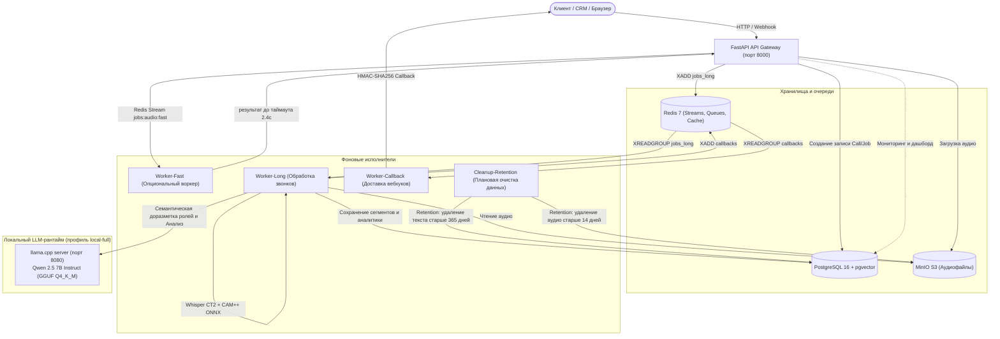

# Платформа речевой аналитики и голосового поиска (`apc-speech`)

Автономный промышленный сервис локального распознавания русской речи, интеллектуальной диаризации, семантического анализа телефонных звонков и ультра-быстрого голосового поиска для сферы наружной рекламы (Outdoor Advertising).

Сервис спроектирован для работы **в закрытом контуре (On-Premise / Private Cloud)** без передачи звуковых и текстовых данных во внешние публичные облака.

---

## Оглавление

1. [Архитектура системы](#архитектура-системы)
2. [Профили запуска (`small` vs `local-full`)](#профили-запуска-small-vs-local-full)
3. [Полный пайплайн обработки звонка](#полный-пайплайн-обработки-звонка)
4. [Алгоритмы и модели](#алгоритмы-и-модели)
   * [Распознавание речи (ASR)](#распознавание-речи-asr)
   * [Акустическая диаризация (CAM++ + Якоря + HMM Витерби)](#акустическая-диаризация-cam--якоря--hmm-витерби)
   * [Семантическая доразметка ролей через LLM](#семантическая-доразметка-ролей-через-llm)
   * [Детерминированные речевые метрики](#детерминированные-речевые-метрики)
   * [Маскирование персональных данных (PII)](#маскирование-персональных-данных-pii)
   * [Смысловой анализ и контроль качества (LLM)](#смысловой-анализ-и-контроль-качества-llm)
5. [Возможные недостатки и краевые случаи (Known Limitations)](#возможные-недостатки-и-краевые-случаи-known-limitations)
6. [Быстрый старт и развертывание](#быстрый-старт-и-развертывание)
7. [Контракт API и примеры вызовов](#контракт-api-и-примеры-вызовов)
   * [Синхронный голосовой поиск (`/v1/voice/search`)](#7-сверхбыстрый-синхронный-голосовой-поиск-post-v1voicesearch)
   * [Общая история запросов (`/v1/voice/history`)](#8-общая-серверная-история-голосовых-запросов-get--delete-v1voicehistory)
8. [Интеграция с телефонией CRM (Битрикс24)](#интеграция-с-телефонией-crm-битрикс24)
9. [Веб-дашборд (Аналитика звонков и Голосовой поиск)](#веб-дашборд)
10. [Структура репозитория](#структура-репозитория)
11. [Тестирование и контроль качества](#тестирование-и-контроль-качества)
12. [Оценочный стенд и результаты замеров](#оценочный-стенд-и-результаты-замеров)

---

## Архитектура системы

Сервис реализован по архитектуре **модульного монолита с выделенными фоновыми воркерами (Modular Monolith with Dedicated Workers)**:



### Основные компоненты комплекса:

1. **`api` (FastAPI / Uvicorn)**:
   * REST API endpoints, валидация входящих запросов, проверка токенов (Bearer / Dev-Token) с синхронизацией отозванных токенов через Redis.
   * Потоковая загрузка аудиофайлов напрямую во временные файлы без дублирования в оперативной памяти (защита от OOM).
   * Защита от SSRF при скачивании аудио по URL (валидация каждого редиректа, блокировка loopback, RFC1918, link-local, облачных metadata-сервисов и потоковое ограничение размера).
   * Синхронный голосовой поиск: API ставит запрос в отдельную Redis-очередь (`jobs:audio:fast`) и ждёт результат от `worker-fast` не дольше `VOICE_SEARCH_RESULT_TIMEOUT_SEC`; при недоступности очереди предусмотрен explicit in-process fallback через пул потоков с семафором (`VOICE_SEARCH_MAX_CONCURRENCY`, по умолчанию 1) для локальной разработки и тестов. Фактическая задержка зависит от CPU-инструкций и доступной квоты; текущие замеры и ограничения приведены в `docs/benchmark-report.md`.
   * Раздача веб-дашборда с интерактивным аудиоплеером и караоке-таймкодами.
   * Health/Readiness пробы (`/health`, `/ready`) и Prometheus метрики (`/metrics`).
2. **`worker-long` (Python Async Worker)**:
   * Читает очередь `jobs_long` через Redis Streams (с поддержкой Consumer Groups, Pending Entries List и очереди недоставленных сообщений DLQ `jobs:audio:dlq`).
   * Проверяет жесткие лимиты длительности аудио (`MAX_AUDIO_DURATION_HOURS`) и выполняет экспоненциальный retry при временных сбоях.
   * Выполняет полный конвейер: чанкинг, ASR (Whisper), CAM++ диаризацию, марковское сглаживание, LLM-доразметку ролей, расчет акустических метрик, PII-маскирование и строгую валидацию JSON-схемы анализа.
3. **`worker-callback` (Python Async Worker)**:
   * Гарантированная доставка вебхуков с результатами анализа в вызывающие системы с расчетом HMAC-SHA256 подписи в заголовке `X-Apc-Signature` (формат `sha256=HMAC(...)`), `X-Apc-Timestamp` и экспоненциальным backoff (5 попыток: 5с, 15с, 60с, 300с, 900с). Блокировка редиректов и приватных сетей для защиты от SSRF.
4. **`cleanup-retention` (Python Background Loop Worker)**:
   * Автономный фоновый сервис соблюдения раздельных политик хранения (GDPR/152-ФЗ): ежедневно удаляет аудиозаписи из MinIO старше `RETENTION_AUDIO_DAYS` (по умолчанию 14 дней) и текстовые транскрипты/анализы из PostgreSQL старше `RETENTION_TEXT_DAYS` (по умолчанию 365 дней).
5. **`worker-fast` (Python Async Worker)**:
   * Обязательный выделенный воркер синхронного голосового поиска. API помещает запрос в отдельный Redis Stream `jobs:audio:fast`, ожидает результат не дольше `VOICE_SEARCH_RESULT_TIMEOUT_SEC` и при перегрузке/таймауте возвращает `503` с `Retry-After`.
6. **`llm-runtime` (llama.cpp server, профиль `local-full`)**:
   * Контейнер на базе `ghcr.io/ggml-org/llama.cpp:server-b4738`.
   * Обслуживает локальную квантованную модель `Qwen 2.5 7B Instruct` (`qwen2.5-7b-instruct-q4_k_m.gguf` или шарды, 4.4 ГБ).
   * Предоставляет OpenAI-совместимый эндпоинт `/v1/chat/completions` со строгим форсированием JSON-схем (`json_schema`).
7. **`postgres` (PostgreSQL 16 + pgvector)**:
   * Хранит звонки (`calls`), задачи (`jobs`), порепличные сегменты (`transcript_segments`), структурированные анализы (`analyses`), историю вебхуков (`callback_logs`) и эмбеддинги фраз (`embeddings`).
8. **`redis` (Redis 7 Alpine)**:
   * Персистентные потоки задач Redis Streams, rate limiting (Sliding Window), кэширование токенов.
9. **`minio` (S3-совместимое объектное хранилище)**:
   * Хранение исходных и обработанных аудиозаписей с presigned URL доступом и поддержкой жизненного цикла (retention policy).


---

## Профили запуска (`small` vs `local-full`)

Система поддерживает два режима развертывания, переключаемых переменной `APP_PROFILE` в файле [`.env`](.env):

| Параметр | Профиль `small` (по умолчанию) | Профиль `local-full` |
| :--- | :--- | :--- |
| **Целевое железо** | 2 vCPU, 4 ГБ RAM, без GPU (п. «Ограничения» brief.md) | 8 vCPU, 32 ГБ RAM или GPU от 12 ГБ (п. «Ограничения» brief.md) |
| **Контейнер LLM** | Не запускается (0 МБ ОЗУ) | Запущен `llm-runtime` (лимит 10240 МБ ОЗУ, фактическое использование ~3.3–4.0 ГБ) |
| **Распознавание речи** | `faster-whisper` (int8 на CPU) | `faster-whisper` (int8 на CPU) |
| **Акустическая диаризация** | CAM++ ONNX + Якоря + HMM Витерби | CAM++ ONNX + Якоря + HMM Витерби |
| **Семантическая доразметка ролей** | Регулярные выражения и эвристики | **Qwen 2.5 7B** (семантическая проверка реплик) |
| **Анализ звонка и чек-лист** | Детерминированный rule-based анализатор | **Qwen 2.5 7B** (глубокий анализ по JSON-схеме) |
| **Саммари звонка** | Шаблонное резюме по ключевым словам | Живой человекочитаемый смысловой пересказ |
| **Запуск** | `APP_PROFILE=small docker compose up -d` | `APP_PROFILE=local-full docker compose --profile local-full up -d` |

---

## Полный пайплайн обработки звонка

Каждая аудиозапись, поступающая в `worker-long`, последовательно проходит следующие этапы:

```
[Аудиозапись (MP3/WAV/OGG/AAC)]
            │
            ▼ (Шаг 1: Препроцессинг)
  FFmpeg 16kHz 16-bit PCM + Проверка изоляции каналов
   ├── Если Stereo и каналы изолированы -> Стерео-сплит (ch0=manager, ch1=client)
   └── Если Mono или Dual-Mono -> Моно-пайплайн
            │
            ▼ (Шаг 2: Адаптивный чанкинг & VAD)
  Silero VAD v5 находит естественные паузы тишины (длина чанков 60-180с)
            │
            ▼ (Шаг 3: ASR Распознавание речи)
  faster-whisper (CTranslate2 int8) -> Слова с таймкодами + ITN нормализация
            │
            ▼ (Шаг 4: Акустическая диаризация)
  split_segment_into_turns -> CAM++ ONNX (192-dim) -> Якорная кластеризация -> HMM Витерби
            │
            ▼ (Шаг 5: Семантическая доразметка ролей)
   ├── В профиле local-full: Запрос в Qwen 2.5 7B (исправление перепутанных ролей)
   └── В профиле small: Регулярные выражения и речевые паттерны
            │
            ▼ (Шаг 6: Речевые метрики)
  Расчет пауз, перебиваний, долей речи, WPM менеджера и клиента (чистая математика)
            │
            ▼ (Шаг 7: PII-маскирование и сохранение в БД)
  Regex + Natasha NER скрывают телефоны, email, карты, паспорта -> Запись в PostgreSQL
            │
            ▼ (Шаг 8: Смысловой бизнес-анализ)
   ├── В профиле local-full: Qwen 2.5 7B генерирует JSON-анализ, чек-лист, договоренности
   └── В профиле small: Rule-based анализатор (taxonomy.yaml, checklist.yaml)
            │
            ▼ (Шаг 9: Доставка вебхуков)
  Worker-Callback отправляет HMAC-подписанный JSON клиенту (callback_url) и в CRM Битрикс24
```

---

## Алгоритмы и модели

### Распознавание речи (ASR)
* **Движок**: `faster-whisper` на базе оптимизированного C++ рантайма **CTranslate2**.
* **Модели**:
  * Основная: `./models/whisper-podlodka-turbo-ct2` (адаптированная русскоязычная Turbo-модель).
  * Поддерживаются стандартные веса: `small`, `base`, `large-v3`.
* **Квантование**: `int8` на CPU, обеспечивающее скорость транскрипции в 3–5 раз быстрее реального времени на обычных серверных ядрах без GPU.
* **Таймкоды слов**: флаг `word_timestamps=True` извлекает точные временные границы каждого слова для разделения реплик и подсчета темпа речи.
* **Специализированная нормализация (`RussianTextNormalizer`)**:
  * Преобразует числительные в форматы наружной рекламы («три на шесть» $\rightarrow$ «3×6», «ситиборд два на четыре» $\rightarrow$ «ситиборд 2×4»).
  * Распознает и форматирует денежные суммы («сто пятьдесят тысяч рублей» $\rightarrow$ «150 000 руб.»).
  * Корректирует специфические топонимы (МКАД, ТТК, шоссе, станции метро Москвы и МО).
  * Выполняет фонетическую нормализацию акустических омофонов терминов наружной рекламы («сити борт», «сети борд», «сеть борд», «сетиборд» $\rightarrow$ «ситиборд»).
* **Контекстная подсказка словаря (`initial_prompt` & `hotwords`)**:
  * Whisper инициализируется предметным словарём наружной рекламы (*«ситиборд ситиборды ситиборда ситибордов билборд суперсайт сити-формат медиафасад»*), исключая ложные акустические интерпретации редких отраслевых терминов.
* **Математическая оценка достоверности (`confidence`)**:
  * Уровень уверенности вычисляется как среднее геометрическое вероятностей токенов на основе средних лог-вероятностей сегмента $\exp(\text{avg\_logprob})$ в диапазоне $[0.0, 1.0]$.


---

### Акустическая диаризация (CAM++ + Якоря + HMM Витерби)

В модуле [`app/diarization/mono_diarizer.py`](app/diarization/mono_diarizer.py) реализован трехступенчатый акустический алгоритм:

1. **Разбиение сегментов на реплики (`split_segment_into_turns`)**:
   * Whisper часто объединяет в один сегмент фразу менеджера и ответ клиента, если между ними была короткая пауза.
   * Алгоритм анализирует таймкоды соседних слов: если пауза $\ge 0.35$ с или слово оканчивается знаком препинания (`.`, `?`, `!`) при паузе $\ge 0.20$ с, сегмент разделяется на независимые реплики.
2. **Извлечение нейросетевых d-векторов CAM++**:
   * Используется модель **CAM++** (`models/campplus.onnx`, 28 МБ) через `onnxruntime` на CPU.
   * На входе: 80-полосные log Mel-фильтры (fbank), вычисляемые через `librosa`.
   * На выходе: 192-мерный нормализованный вектор акустического отпечатка голоса.
   * Для коротких реплик ($< 0.8$ с) применяется симметричный контекстный паддинг окружающего аудио для исключения артефактов граничных условий.
3. **Якорная кластеризация (`_find_anchor_centroids`)**:
   * Из всех реплик отбираются кандидаты с длительностью $\ge 2.0$ с (чистый голос без шумов междометий).
   * Вычисляется матрица косинусных расстояний $D_{ij} = 1 - \langle \mathbf{x}_i, \mathbf{x}_j \rangle$.
   * Находится пара кандидатов с максимальным расстоянием — голосовые полюса Спикера 0 и Спикера 1.
   * Вокруг них группируются остальные длинные реплики для формирования устойчивых центроидов $C_0$ и $C_1$.
   * Если максимальная дистанция $< 0.08$ (`min_speaker_distance`), звонок классифицируется как **монолог** одного человека (`SPEAKER_0`).
   * **Двухэтапная верификация монолога**: после распределения реплик дополнительно анализируется пропорция реплик редкого спикера (`turn_ratio < 0.08`) и коэффициент силуэта кластеризации (`silhouette_score < 0.12`). В монологах, художественных чтениях (басни, стихи) или монологах автоответчика запись гарантированно маркируется единым спикером `SPEAKER_0` без ложного появления второго спикера из-за случайных вздохов или фоновых шумов.
4. **Марковское сглаживание переходов Витерби (`_viterbi_smoothing`)**:
   * Решает проблему «дрожания» спикеров на коротких словах («да», «ага», «алло»).
   * Вычисляется относительная нормализованная маржа сходства:
     $$\Delta s_i = \frac{\langle \mathbf{x}_i, C_0 \rangle - \langle \mathbf{x}_i, C_1 \rangle}{1 - \langle C_0, C_1 \rangle}$$
     Это гарантирует контрастность сигнала (от $-1.0$ до $+1.0$) даже для двух очень похожих мужских или женских голосов.
   * Вероятность смены спикера $P(\text{switch})$ зависит от паузы между репликами:
     * Пауза $< 0.25$ с: $P(\text{switch}) = 0.15$ (человек продолжает свою мысль).
     * Пауза $0.25$–$0.50$ с: $P(\text{switch}) = 0.35$.
     * Пауза $\ge 0.50$ с: $P(\text{switch}) = 0.50$ (естественная диалоговая пауза).
   * Алгоритм динамического программирования Витерби восстанавливает глобально оптимальную последовательность спикеров.

---

### Семантическая доразметка ролей через LLM

В профиле `local-full` в модуле [`app/llm/local_adapter.py`](app/llm/local_adapter.py) подключен метод [`refine_speaker_roles`](app/llm/local_adapter.py#L96-L190):

* Перед сохранением в базу данных список всех реплик отправляется в модель **Qwen 2.5 7B Instruct**.
* Модель оценивает прагматику реплик (вопрос-ответ, предложение условий, презентация компании, запрос счета) и возвращает строгий JSON-массив:
  ```json
  { "roles": ["manager", "client", "manager", "client", ...] }
  ```
* Если акустическая диаризация случайно перепутала спикера на короткой фразе, семантическая модель возвращает ей истинную роль.
* В случае таймаута или ошибки сети система автоматически откатывается на результаты эвристического классификатора без падения задачи.

---

### Детерминированные речевые метрики

Модуль [`app/metrics/speech_metrics.py`](app/metrics/speech_metrics.py) рассчитывает объективные показатели речи **строго детерминированным кодом (без участия нейросетей и без риска галлюцинаций)**:

* **Доли речи (`manager_speech_share`, `client_speech_share`)**: процент чистого времени говорения каждого участника.
* **Количество перебиваний (`interruptions_count`)**: случаи, когда один участник начинает говорить во время речи другого с перекрытием более $0.3$ секунды.
* **Длительность тишины (`silence_duration_sec`)**: суммарное время пауз в разговоре (вычисляется через математическое объединение отрезков активной речи).
* **Темп речи (`manager_wpm`, `client_wpm`)**: скорость говорения в словах в минуту.

---

### Маскирование персональных данных (PII)

Модуль [`app/pii/masker.py`](app/pii/masker.py) гарантирует безопасность хранения клиентских данных:

* Номера телефонов (РФ и международные форматы) $\rightarrow$ `[PHONE_NUMBER]`.
* Адреса электронной почты $\rightarrow$ `[EMAIL]`.
* Номера банковских карт (алгоритм Луна и маски по 16 цифрам) $\rightarrow$ `[BANK_CARD]`.
* Серии и номера паспортов РФ $\rightarrow$ `[PASSPORT]`.
* Маскирование выполняется **до** передачи текста в блок семантического анализа и сохранения в публичные поля транскрипта.

---

### Смысловой анализ и контроль качества (LLM)

В профиле `local-full` LLM заполняет контракт согласно схеме [`schemas/analysis_schema_v1.json`](schemas/analysis_schema_v1.json):

1. **`summary`**: связный пересказ сути разговора до 1000 символов.
2. **`call_result`**: итог (`success_deal`, `follow_up_scheduled`, `info_provided`, `client_declined`, `unclear_spam`).
3. **`inquiry_type`**: тематика (`pricing`, `availability`, `inventory_search`, `complaint` и др.).
4. **`entities`**: извлеченные города, рекламные форматы, объемы, бюджет и планируемые периоды.
5. **`agreements`**: список конкретных обязательств сторон с дедлайнами (`who`, `what`, `deadline`).
6. **`sentiment`**: тональность клиента (`positive`, `neutral`, `negative`, `conflict`) и тон менеджера (`polite_constructive`, `indifferent`, `rude`).
7. **`manager_checklist`**: автоматическая оценка звонка по 5 критериям:
   * Приветствие и представление компании.
   * Выявление потребностей клиента.
   * Предложение вариантов размещения.
   * Озвучивание следующего шага взаимодействия.
   * Фиксация контактов клиента.
   * Поиск запрещенных стоп-слов из `config/checklist.yaml`.
   * Итоговый скоринг менеджера от 0 до 5.

   > [!NOTE]
   > Чек-лист разработан строго под оценку коммерческих переговоров в сфере продаж наружной рекламы. Если запись не содержит этапов коммерческой сделки, критерии чек-листа обоснованно получают значение `false`, а итоговый скоринг равен 0.

### Внешний провайдер аналитики (выключен по умолчанию)

Отдельный адаптер `app/llm/external_adapter.py` за портом — только для разбора
текста (не для распознавания). Включается явным флагом и получает **только
маскированный текст** (перед отправкой — `assert_no_leaked_pii`):

```env
LLM_EXTERNAL_PROVIDER_ENABLED=true
LLM_EXTERNAL_PROVIDER_URL="https://api.example.com/v1/chat/completions"
LLM_EXTERNAL_PROVIDER_API_KEY="..."
LLM_EXTERNAL_PROVIDER_MODEL="gpt-4o-mini"
```

По умолчанию `LLM_EXTERNAL_PROVIDER_ENABLED=false` — адаптер отвечает 403
`external_provider_disabled`, внешний трафик отсутствует.

---

## Возможные недостатки и краевые случаи (Known Limitations)

Для обеспечения прозрачности эксплуатации ниже приведены сценарии, в которых математические эвристики или локальная модель могут допускать неточности:

### 1. Экстремально асимметричный диалог в моно-записи
* **Суть**: Менеджер произносит длинные фразы по 10 секунд, а клиент на протяжении всего звонка отвечает исключительно односложно: *«Да»*, *«Алло»*, *«Угу»* (ни одной фразы длительнее $1.5$ с).
* **Следствие**: Алгоритм якорной кластеризации CAM++ отберет в качестве якорей фразы только менеджера. Если вариативность голоса менеджера низкая, акустическая модель может счесть запись монологом и окрасить поддакивания клиента в цвет менеджера.
* **Компенсация**: В профиле `local-full` семантическая доразметка Qwen выправляет подобные реплики по смыслу контекста.

### 2. Быстрые перебивания речи с минимальной паузой (Cross-talk)
* **Суть**: Один собеседник вклинивается со словом *«Подождите»* в микропаузу речи другого собеседника ($< 0.2$ с).
* **Следствие**: Из-за штрафа марковской модели за частые перескоки на коротких интервалах слово *«Подождите»* может быть приписано первому говорящему.

### 3. Резкая смена акустического тракта одним человеком
* **Суть**: Собеседник в процессе звонка переключается с телефонной трубки на громкую связь в автомобиле (появляется реверберация помещения и шум дороги).
* **Следствие**: CAM++ может воспринять изменившийся спектральный окрас одного и того же человека как появление второго спикера.

### 4. Производительность LLM на чистом CPU
* **Суть**: Инференс Qwen 2.5 7B на 4 ядрах CPU через llama.cpp генерирует текст со скоростью ~4.8–5.2 токенов/сек.
* **Следствие**: Полный смысловой анализ 3-минутного звонка занимает около 20–35 секунд (включая проверку ролей). Это полностью штатно для фоновой асинхронной очереди `worker-long`, но не подходит для синхронного realtime-ответа.

### 5. Лимит контекстного окна LLM
* **Суть**: В `docker-compose.yml` размер контекста `llama-server` сконфигурирован флагом `-c 4096`.
* **Следствие**: Звонки длительностью свыше 40 минут с непрерывной речью требуют предварительного сжатия или чанкинга транскрипта перед отправкой в LLM во избежание превышения лимита токенов.

---

## Быстрый старт и развертывание

### Требования к системе
* **ОС**: Linux (Ubuntu 22.04+, Debian 12, Arch Linux, RHEL 9).
* **Docker & Docker Compose**: Docker Engine 24+ с поддержкой Docker Compose v2.
* **Ресурсы**:
  * Профиль `small`: 2 vCPU, 4 ГБ RAM, без GPU, 10 ГБ на диске (п. «Ограничения» brief.md).
  * Профиль `local-full`: 8 vCPU, 32 ГБ RAM или GPU от 12 ГБ, 20 ГБ на диске (п. «Ограничения» brief.md).
* **Процессор — обязательно с AVX2** (проверить: `grep -o avx2 /proc/cpuinfo | head -1`; сервис сам
  сообщает флаг в `GET /health` → `details.avx2` и пишет предупреждение в лог при отсутствии).
  Без AVX2 int8-инференс CTranslate2 деградирует на порядок: SLA голосового поиска (10 с → 2,5 с)
  и RTF часовой записи недостижимы (замер B1 в `docs/known-issues.md`, п.5–6).

### 1. Клонирование и настройка окружения
```bash
git clone https://github.com/zetgame123/apc-speech.git
cd apc-speech
cp .env.example .env
```

Отредактируйте `.env`:
* Для базового легковесного режима: `APP_PROFILE=small`
* Для режима с локальной нейросетью Qwen 2.5 7B: `APP_PROFILE=local-full`

Дальше выбирайте **один** из двух режимов авторизации — они переключаются переменной `APP_ENV`
и взаимоисключающие (см. `authenticate_token()` в `app/core/security.py`):

#### Вариант 1 — тестовый стенд (локальная разработка, демо, CI)
```env
APP_ENV=development
DEV_TOKEN=my-dev-secret-123
```
При `APP_ENV` ≠ `production` сервис принимает значение `DEV_TOKEN` как есть, без хэширования —
во всех запросах просто передавайте `Authorization: Bearer my-dev-secret-123`. Токен даёт полный
доступ (`admin`+`write`+`read`) без привязки к `namespace`. Удобно для быстрого старта, но
**использовать в production запрещено** — токен хранится в `.env` в открытом виде.

#### Вариант 2 — production
```env
APP_ENV=production
DEV_TOKEN=
API_TOKENS_HASHED="<sha256_hash>:<scopes>:<namespace>"
```
При `APP_ENV=production` проверка `DEV_TOKEN` полностью отключается в коде (независимо от того,
задано ли значение) — попытка использовать его вернёт `401 invalid_token`. Единственный способ
авторизации — список хэшированных токенов в `API_TOKENS_HASHED`.

Формат одной записи: `sha256_hash_токена:scope1+scope2:namespace` (несколько записей — через
запятую; `namespace` можно не указывать — тогда токен работает для любого namespace).

Как выпустить токен:
```bash
# 1. Сгенерировать случайный токен
TOKEN=$(python3 -c "import secrets; print(secrets.token_hex(32))")
echo "Выдайте этот токен клиенту: $TOKEN"

# 2. Посчитать его SHA-256 — именно хэш идёт в .env, исходный токен на сервере не хранится
python3 -c "import hashlib; print(hashlib.sha256('$TOKEN'.encode()).hexdigest())"
```
Результат впишите в `.env`, например:
```env
API_TOKENS_HASHED="a1b2c3...:admin+write+read:outdoor_msk"
```
Клиент при этом использует **не хэш, а исходный `$TOKEN`** в заголовке `Authorization: Bearer`.

#### Общее для обоих вариантов
Независимо от режима авторизации, обязательно задайте:
```env
CALLBACK_SIGNING_SECRET=$(openssl rand -base64 32)
```
Секрет минимум 32 символа, используется для HMAC-подписи исходящих callback-запросов
(`sign_callback_payload()` в `app/core/security.py`). Для production также смените пароли
`DB_PASSWORD` и `MINIO_ROOT_PASSWORD`/`S3_SECRET_KEY` (должны совпадать между собой — `DB_PASSWORD`
используется и в `DATABASE_URL`, `MINIO_ROOT_PASSWORD` — в `S3_SECRET_KEY`, см. полный список
переменных в `.env.example`) и ограничьте `CORS_ALLOWED_ORIGINS` конкретными доменами фронтенда
вместо `*`.

> После любого изменения `.env` перечитать его смогут только пересозданные контейнеры:
> `docker compose up -d --force-recreate api worker-long worker-callback` (простой `restart` не
> подхватит новые переменные, если контейнер уже был создан с другими).

### 2. Загрузка моделей

Загрузка весов моделей **интегрирована в `docker-compose.yml`** и выполняется автоматически
одноразовым сервисом `model-downloader` (CAM++ + whisper-small + whisper-podlodka-turbo-ct2) перед
стартом `api`/воркеров, и `model-downloader-llm` (Qwen2.5-7B GGUF, ~4.4 ГБ) перед стартом
`llm-runtime` в профиле `local-full`. Ручной запуск не требуется — `docker compose up` сам всё
скачает при первом старте. Для полного режима обязательно передайте `APP_PROFILE=local-full`,
как показано ниже: сам флаг Compose-профиля не меняет переменные окружения API. Скрипт
идемпотентен: при повторных запусках уже скачанные файлы не
перекачиваются.

Ручной запуск (например, для прогрева кэша перед сборкой образов) всё ещё доступен:

```bash
# Для профиля small (модель поиска whisper-small + модель длинного ASR whisper-podlodka-turbo-ct2 + CAM++ ONNX):
uv run python scripts/download_models.py --profile small

# Для профиля local-full (дополнительно загружает Qwen 2.5 7B Instruct GGUF, ~4.4 ГБ):
uv run python scripts/download_models.py --profile local-full
```

Загруженные файлы сохраняются в `./models/`:
* `models/campplus.onnx` (~28 МБ) — эмбеддинги спикеров для моно-диаризации;
* `models/whisper-small/` (~960 МБ) — ультрабыстрое распознавание короткого голосового поиска;
* `models/whisper-podlodka-turbo-ct2/` (~1.6 ГБ) — оптимизированная модель для длинных русскоязычных звонков;
* `models/qwen2.5-7b-instruct-q4_k_m-*.gguf` (~4.4 ГБ, только для `local-full`) — локальная LLM для семантического анализа.

### 3. Запуск контейнеров

```bash
# 1. Запуск базового профиля small (2 vCPU / 4 ГБ RAM, без LLM):
# Поднимает Postgres, Redis, MinIO, миграции Alembic, API, worker-long, worker-callback, cleanup-retention
APP_PROFILE=small docker compose up -d --build

# 2. Запуск полного локального профиля local-full (с локальным LLM-рантаймом Qwen 2.5 7B):
APP_PROFILE=local-full docker compose --profile local-full up -d --build
```

### 4. Проверка состояния
```bash
# Статус всех контейнеров
docker compose --profile local-full ps

# Проверка API и динамического профиля
curl -s http://localhost:8000/health | jq .
```
Ответ:
```json
{
  "status": "ok",
  "version": "1.0.0",
  "profile": "local-full",
  "app_profile": "local-full",
  "llm_model": "qwen2.5-7b-instruct"
}
```

---

## Контракт API и примеры вызовов

Все запросы авторизуются через заголовок `Authorization: Bearer <TOKEN>`.
Токены привязаны к областям видимости (`admin`, `write`, `read`) и могут быть изолированы по конкретному `namespace`.

### Общие принципы контракта (`common-requirements.md`):
* **Версионирование**: все рабочие маршруты находятся под префиксом `/v1/`.
* **Заголовок `X-Request-Id`**: принимается от клиента или генерируется сервисом, возвращается во всех ответах и пишется в логи.
* **Единый формат ошибок**:
  ```json
  {
    "error": "machine_slug",
    "message": "Понятное описание на русском языке",
    "details": {}
  }
  ```
  Коды ответов: `400` (неверные параметры), `401` (нет токена), `403` (недостаточно прав / чужой namespace), `404` (не найдено), `409` (конфликт идемпотентности), `413` (превышен лимит размера), `422` (ошибка валидации схемы), `429` (лимит запросов с заголовком `Retry-After`), `5xx` (сбой сервиса).
* **Лимиты и ёмкость**: `429` возвращается при превышении rate limit (`RATE_LIMIT_REQUESTS_PER_WINDOW` за `RATE_LIMIT_WINDOW_SEC`), а также когда число заданий в статусах `queued`/`running` достигает `MAX_PENDING_JOBS` (по умолчанию 100). Скачивание по URL идёт в фоне после `202`; зависшие `pending_download` старше `PENDING_DOWNLOAD_TIMEOUT_SEC` (по умолчанию 600 с) уборщик переводит в `failed` с callback. Все переменные — в `.env.example` с комментариями.
* **Идемпотентность**: поддержка заголовка `Idempotency-Key` и автоматическая дедупликация по SHA-256 хэшу файла и параметров.

---

### 1. Создание задания на обработку аудиозаписи

Сервис поддерживает **3 способа передачи аудио**:

#### Вариант А: Загрузка файла (`POST /v1/jobs/upload`)
Поддерживает форматы `wav`, `mp3`, `ogg`, `opus`, `m4a`, `flac`, `webm` и телефонные кодеки 8 кГц (`G.711 A-law/mu-law`, `GSM`). Загрузка выполняется потоково чанками по 1 МБ с проверкой лимита (до 500 МБ).
```bash
curl -X POST "http://localhost:8000/v1/jobs/upload" \
  -H "Authorization: Bearer my-secure-token" \
  -H "Idempotency-Key: unique-key-12345" \
  -F "namespace=outdoor_msk" \
  -F "file=@call_record.mp3" \
  -F "external_id=crm_lead_12345" \
  -F "direction=inbound" \
  -F "manager_id=mgr_07" \
  -F "client_id=cli_88" \
  -F "channel_manager=0" \
  -F "vocabulary_hints=щиты 3×6, Балашиха, ситиборд" \
  -F "callback_url=https://crm.company.ru/webhooks/speech"
```

#### Вариант Б: Скачивание по URL (`POST /v1/jobs/by-url`)
Аудио скачивается сервисом по ссылке с обязательной проверкой SSRF (блокируются приватные подсети, loopback и облачные метаданные):
```bash
curl -X POST "http://localhost:8000/v1/jobs/by-url" \
  -H "Authorization: Bearer my-secure-token" \
  -H "Content-Type: application/json" \
  -d '{
    "namespace": "outdoor_msk",
    "url": "https://storage.provider.ru/records/call_999.wav",
    "callback_url": "https://crm.company.ru/webhooks/speech",
    "language": "ru",
    "metadata": {
      "external_id": "crm_call_999",
      "direction": "inbound",
      "manager_id": "mgr_07",
      "client_id": "cli_88"
    },
    "options": {
      "channel_manager": 0,
      "vocabulary_hints": ["суперсайт", "МКАД", "3×6"]
    }
  }'
```

#### Вариант В: Объект в S3/MinIO (`POST /v1/jobs/by-s3`)
Прямой запуск обработки файла, уже находящегося в S3/MinIO:
```bash
curl -X POST "http://localhost:8000/v1/jobs/by-s3" \
  -H "Authorization: Bearer my-secure-token" \
  -H "Content-Type: application/json" \
  -d '{
    "namespace": "outdoor_msk",
    "s3_bucket": "raw-audio",
    "s3_key": "inbox/call_555.wav",
    "callback_url": "https://crm.company.ru/webhooks/speech",
    "options": {
      "vocabulary_hints": ["3×6", "Химки"]
    }
  }'
```

**Ответ `202 Accepted` во всех вариантах**:
```json
{
  "job_id": "9b1deb4d-3b7d-4bad-9bdd-2b0d7b3dcb6d",
  "status": "queued",
  "status_url": "/v1/jobs/9b1deb4d-3b7d-4bad-9bdd-2b0d7b3dcb6d?namespace=outdoor_msk",
  "created_at": "2026-10-01T00:30:00Z"
}
```

---

### 2. Проверка статуса выполнения (`GET /v1/jobs/{job_id}`)
```bash
curl -s "http://localhost:8000/v1/jobs/9b1deb4d-3b7d-4bad-9bdd-2b0d7b3dcb6d?namespace=outdoor_msk" \
  -H "Authorization: Bearer my-secure-token" | jq .
```
**Ответ при завершении**:
```json
{
  "job_id": "9b1deb4d-3b7d-4bad-9bdd-2b0d7b3dcb6d",
  "call_id": "c1a2b3c4-d5e6-7f8a-9b0c-1d2e3f4a5b6c",
  "status": "succeeded",
  "progress": 100,
  "step": "completed",
  "result_url": "/v1/calls/c1a2b3c4-d5e6-7f8a-9b0c-1d2e3f4a5b6c/analysis?namespace=outdoor_msk",
  "error": null,
  "created_at": "2026-10-01T00:30:00Z",
  "updated_at": "2026-10-01T00:30:45Z"
}
```
Статусы задания: `queued` $\to$ `running` (с указанием прогресса 0–100% и текущего шага) $\to$ `succeeded` или `failed`.

---

### 3. Подписанный Callback с результатами (HMAC-SHA256)
При указании `callback_url` сервис отправляет результат завершения задания:
* **Заголовки безопасности**:
  * `X-Apc-Timestamp`: unix-секунды генерации запроса.
  * `X-Apc-Signature`: `sha256=HMAC_SHA256("{timestamp}.{raw_body}", CALLBACK_SIGNING_SECRET)`.
* **Защита от replay-атак**: подпись пересчитывается для каждой попытки, платформа отклоняет запросы старше 5 минут.
* **Надёжность доставки**: не менее 5 попыток с нарастающей задержкой (`[5, 15, 60, 300, 900]` секунд), логирование попыток в БД.

---

### 4. Получение структурированного разбора звонка (`GET /v1/calls/{call_id}/analysis`)
```bash
curl -s "http://localhost:8000/v1/calls/c1a2b3c4-d5e6-7f8a-9b0c-1d2e3f4a5b6c/analysis?namespace=outdoor_msk" \
  -H "Authorization: Bearer my-secure-token" | jq .
```
**Ответ по схеме `analysis_schema_v1.json`**:
```json
{
  "call_id": "c1a2b3c4-d5e6-7f8a-9b0c-1d2e3f4a5b6c",
  "schema_version": "1.0.0",
  "prompt_version": "v1.2-ru-outdoor",
  "summary": "Клиент запросил подбор рекламных поверхностей 3×6 в Балашихе на октябрь. Менеджер предложил свободные щиты и пообещал направить расчет.",
  "call_result": "commercial_offer_requested",
  "inquiry_type": "inventory_search",
  "entities": {
    "cities": ["Балашиха"],
    "formats": ["3×6", "щит"],
    "quantity": 3,
    "target_period": "октябрь",
    "budget_rub": 90000,
    "product_category": "недвижимость"
  },
  "agreements": [
    {
      "who": "manager",
      "what": "Подготовить и отправить коммерческое предложение со свободными сторонами 3×6",
      "deadline": "сегодня до 18:00"
    }
  ],
  "sentiment": {
    "client_overall": "positive",
    "manager_tone": "polite_constructive"
  },
  "manager_checklist": {
    "greeting": true,
    "need_identification": true,
    "options_offered": true,
    "next_step_named": true,
    "contacts_taken": true,
    "forbidden_words_found": [],
    "score": 5
  },
  "deterministic_speech_metrics": {
    "manager_speech_share": 0.54,
    "client_speech_share": 0.41,
    "interruptions_count": 2,
    "pauses_count": 3,
    "manager_wpm": 128,
    "client_wpm": 114
  }
}
```

---

### 5. Получение расшифровки звонка (`GET /v1/calls/{call_id}/transcript`)
Поддерживает 4 формата выдачи (`format=json|text|srt|vtt`) и управление маскированием (`masked=true|false`):
```bash
# JSON с посегментными и пословными таймкодами
curl -s "http://localhost:8000/v1/calls/c1a2b3c4-d5e6-7f8a-9b0c-1d2e3f4a5b6c/transcript?namespace=outdoor_msk&format=json" \
  -H "Authorization: Bearer my-secure-token"

# SRT субтитры
curl -s "http://localhost:8000/v1/calls/c1a2b3c4-d5e6-7f8a-9b0c-1d2e3f4a5b6c/transcript?namespace=outdoor_msk&format=srt" \
  -H "Authorization: Bearer my-secure-token"

# VTT субтитры
curl -s "http://localhost:8000/v1/calls/c1a2b3c4-d5e6-7f8a-9b0c-1d2e3f4a5b6c/transcript?namespace=outdoor_msk&format=vtt" \
  -H "Authorization: Bearer my-secure-token"

# Чистый текст реплик
curl -s "http://localhost:8000/v1/calls/c1a2b3c4-d5e6-7f8a-9b0c-1d2e3f4a5b6c/transcript?namespace=outdoor_msk&format=text" \
  -H "Authorization: Bearer my-secure-token"
```

---

### 6. Поиск звонков и фильтры (`GET /v1/calls`)
Поддерживает полнотекстовый поиск по содержимому расшифровок, фильтры и курсорную пагинацию:
```bash
curl -s "http://localhost:8000/v1/calls?namespace=outdoor_msk&q=Балашиха&inquiry_type=inventory_search&limit=20" \
  -H "Authorization: Bearer my-secure-token"
```
**Параметры**:
* `q`: полнотекстовый поиск по тексту реплик.
* `manager_id`: фильтрация по ID менеджера.
* `inquiry_type`: фильтрация по теме из таксономии.
* `date_from` / `date_to`: временной диапазон.
* `cursor`: курсор для постраничной навигации (`next_cursor` в ответе).

---

### 7. Сверхбыстрый синхронный голосовой поиск (`POST /v1/voice/search`)
Предназначен для голосового ввода в интерфейсе («щиты 3×6 в Балашихе»):
```bash
curl -X POST "http://localhost:8000/v1/voice/search?namespace=outdoor_msk&language=ru" \
  -H "Authorization: Bearer my-secure-token" \
  -H "Content-Type: audio/wav" \
  --data-binary "@query_voice.wav"
```
**Целевое время ответа — $\le 2.5$ секунды; текущие фактические результаты приведены в `docs/benchmark-report.md`.**
```json
{
  "text": "щиты 3×6 на Кутузовском проспекте свободен ноябрь",
  "language": "ru",
  "confidence": 0.96,
  "duration_sec": 3.42,
  "processing_time_ms": 1250
}
```
* **Приватность и Zero Audio Retention**: аудиозапись голосового запроса обрабатывается исключительно в оперативной памяти (in-memory buffer) и **никогда не сохраняется на диск, в базу данных или в S3/MinIO**.

---

### 8. Общая серверная история голосовых запросов (`GET / DELETE /v1/voice/history`)

История голосовых запросов централизованно хранится в Redis (`voice:history:{namespace}`) и доступна синхронно всем пользователям и устройствам внутри namespace:
* **Защита доступа**: эндпоинт `GET /v1/voice/history` требует область видимости (scope) `read`, а `DELETE /v1/voice/history` — scope `admin`.
* **PII-маскирование**: перед сохранением в историю текст запроса автоматически очищается от персональных данных (телефоны, банковские карты, паспорта, e-mail) с помощью `PiiMasker`.
* **Срок хранения (TTL) и GDPR**: для ключей истории в Redis выставляется TTL согласно политике удержания (`RETENTION_AUDIO_DAYS * 86400` сек). При вызове GDPR-удаления данных (`POST /v1/admin/gdpr/delete`) история также гарантированно очищается.

#### Получение истории запросов (`GET /v1/voice/history`)
```bash
curl -s "http://localhost:8000/v1/voice/history?namespace=outdoor_msk" \
  -H "Authorization: Bearer my-secure-token" | jq .
```
**Ответ**:
```json
{
  "items": [
    {
      "id": "d10e8e6e-7f41-4f8c-837f-664574c37740",
      "text": "щиты 3×6 на Кутузовском проспекте свободен ноябрь",
      "language": "ru",
      "confidence": 0.96,
      "duration": 3.42,
      "latency": 1250,
      "method": "🎤 Голосовой",
      "created_at": "2026-10-02T21:31:57Z",
      "timestamp": "21:31:57"
    }
  ],
  "count": 1
}
```

#### Очистка истории запросов (`DELETE /v1/voice/history`)
```bash
curl -X DELETE "http://localhost:8000/v1/voice/history?namespace=outdoor_msk" \
  -H "Authorization: Bearer my-secure-token"
```
**Ответ**: `{"status": "ok", "deleted": 1}`.

#### Тестовый синтетический аудиосемпл (`GET /v1/voice/sample-audio`)
Генерирует чистый синтетический WAV-аудиопоток в памяти без записи на диск для быстрой проверки аудиотракта, каналов связи и автоматических health-чеков:
```bash
curl -s "http://localhost:8000/v1/voice/sample-audio?duration_sec=3" -o sample.wav
```

---

### 9. Сводная аналитика и тренды (`GET /v1/analytics/summary`)
```bash
curl -s "http://localhost:8000/v1/analytics/summary?namespace=outdoor_msk&date_from=2026-09-01T00:00:00Z" \
  -H "Authorization: Bearer my-secure-token" | jq .
```
Возвращает:
* Общее число звонков.
* Распределение звонков по темам таксономии (`pricing`, `inventory_search`, и др.).
* Топ упоминаемых городов и форматов конструкций.
* Средние показатели выполнения каждого пункта чек-листа продаж (greeting %, need_id %, options %, next_step %, contacts %).
* Тренды динамики звонков по неделям (ISO-недели).

---

### 10. Семантическая кластеризация текстов (`POST /v1/texts/analyze`)
Группирует пачку текстовых поисковых запросов в смысловые темы без аудио с помощью локального TF-IDF + HDBSCAN/KMeans:
```bash
curl -X POST "http://localhost:8000/v1/texts/analyze" \
  -H "Authorization: Bearer my-secure-token" \
  -H "Content-Type: application/json" \
  -d '{
    "namespace": "outdoor_msk",
    "texts": [
      "щиты 3 на 6 в Балашихе",
      "билборды на шоссе Энтузиастов",
      "стоимость размещения рекламы",
      "прайс лист на щиты",
      "суперсайт на Ленинградке"
    ]
  }'
```
**Ответ**:
```json
{
  "total_texts": 5,
  "clusters": [
    {
      "cluster_id": 1,
      "label": "Подбор инвентаря и локаций",
      "size": 3,
      "representative_queries": ["щиты 3 на 6 в Балашихе", "билборды на шоссе Энтузиастов", "суперсайт на Ленинградке"]
    },
    {
      "cluster_id": 2,
      "label": "Стоимость и прайс-лист",
      "size": 2,
      "representative_queries": ["стоимость размещения рекламы", "прайс лист на щиты"]
    }
  ]
}
```

---

### 11. Экспорт аналитики в CSV (`GET /v1/analytics/export_csv`)
Выгрузка звонков и результатов анализа в формате CSV (доступна также по алиасу `/v1/analytics/export.csv`):
```bash
curl -s "http://localhost:8000/v1/analytics/export_csv?namespace=outdoor_msk" \
  -H "Authorization: Bearer my-secure-token" \
  -o export.csv
```

---

### 12. Удаление данных по 152-ФЗ / GDPR (`DELETE /v1/data/delete`)
Единый эндпоинт для гарантированного удаления персональных данных (требуется scope `admin`):
```bash
# Удаление конкретной записи
curl -X DELETE "http://localhost:8000/v1/data/delete?namespace=outdoor_msk&call_id=c1a2b3c4-..." \
  -H "Authorization: Bearer admin-token"

# Удаление всех данных клиента по client_id
curl -X DELETE "http://localhost:8000/v1/data/delete?namespace=outdoor_msk&client_id=cli_88" \
  -H "Authorization: Bearer admin-token"

# Удаление данных старше определенной даты
curl -X DELETE "http://localhost:8000/v1/data/delete?namespace=outdoor_msk&date_before=2026-01-01T00:00:00Z" \
  -H "Authorization: Bearer admin-token"
```
*Удаляет аудиозаписи из MinIO/S3, транскрипты, сегменты и анализы из PostgreSQL, отменяет активные задания.*

---

### 13. Горячий отзыв токенов без перезапуска (`POST /v1/admin/tokens/revoke`)
```bash
curl -X POST "http://localhost:8000/v1/admin/tokens/revoke" \
  -H "Authorization: Bearer admin-token" \
  -H "Content-Type: application/json" \
  -d '{"token_hash": "sha256_hash_of_revoked_token"}'
```
Отозванные хэши синхронизируются через Redis Set `revoked_tokens` между всеми инстансами API без перезапуска контейнеров.

---

### 14. Служебные эндпоинты
* `GET /health`: отвечает сразу после старта процесса (жив, версия сборки).
* `GET /ready`: ждёт готовности зависимостей **и прогрева моделей** (воркеры
  грузят ASR-модели и делают холостой прогон; флаг `ready` выставляется только
  после `worker_warmup_run_completed`). Холодный старт до `/ready=200` на
  профиль small — порядка **2,5 мин** (замерено 2026-10-11: ~149 с от
  `up -d --build` с кэшированным образом до 200, включая прогрев моделей
  в воркерах). Возвращает `200` или `503`.
* `GET /metrics`: кастомные и системные метрики сервиса в текстовом формате Prometheus:
  * `apc_http_requests_total` — счетчик обработанных HTTP-запросов (по методу, эндпоинту и статус-коду);
  * `apc_http_request_duration_seconds` — гистограмма задержек HTTP-запросов;
  * `apc_jobs_total` — счетчик обработанных фоновых заданий (по статусу и namespace);
  * `apc_voice_search_duration_seconds` — гистограмма длительности распознавания голосового поиска;
  * `apc_queue_size` — глубина очередей задач в Redis Streams.


---

## Интеграция с телефонией CRM (Битрикс24)

### Вебхук телефонии Битрикс24 (`POST /v1/integrations/bitrix24/webhook`)
Сервис поддерживает прием исходящих вебхуков телефонии Битрикс24 (`ONVOICECOMMUNICATIONCALLRECORDING` или `ONEXTERNALCALLFINISHED`):
* Автоматически извлекает URL записи звонка (`RECORD_URL`) и ID звонка (`CALL_ID`).
* Проверяет безопасность URL через SSRF-валидатор.
* Запускает фоновую обработку звонка.
* По окончании анализа автоматически публикует структурированный отчет в таймлайн CRM:
  * Итог звонка и тип обращения.
  * Краткое резюме.
  * Оценку менеджера по чек-листу (0–5).
  * Ключевые договоренности.
* Публикация использует строго маскированный текст для предотвращения утечки персональных данных.

---

## Веб-дашборд

Встроенный веб-интерфейс доступен по адресу **`http://localhost:8000/dashboard`** и включает две специализированные рабочие области:

### 1. Аналитика звонков (Call Analytics)
* **Динамический бейдж профиля**: автоматически опрашивает `/health` и отображает активный режим:
  * `Profile: Small (Rule-Based, 0MB LLM)`
  * `Profile: Local-Full (Qwen 2.5 7B LLM)`
* **Интерактивный плеер и таймлайн спикеров (Speaker Timeline / Gantt chart)**:
  * Воспроизведение оригинальной аудиозаписи через presigned URL MinIO с покадровой визуализацией WaveSurfer.
  * Интерактивная диаграмма таймлайна реплик над плеером с цветовым разделением спикеров (Менеджер — синий `#0284c7`, Клиент — оранжевый `#f97316`) и мгновенным переходом к реплике по клику.
  * Караоке-подсветка текущей реплики синхронно со звуком.
* **Эмоциональный профиль и тональность (Emotion Breakdown)**:
  * Классификация эмоционального состояния клиента (`энтузиазм/радость`, `деловой/спокойный`, `сомнение/скепсис`, `раздражение/гнев`, `тревога/спешка`).
  * Оценка тональности менеджера (`вовлеченный/помогает`, `спокойный/профессиональный`, `безразличный/уставший`, `в защите/раздраженный`).
  * Интерактивный прогресс-бар процентного баланса эмоций (позитив / нейтрал / негатив).
* **Интегральный Compliance Score и аудит нарушений (Violations & Coaching)**:
  * Взвешенный расчет соблюдения скрипта продаж (0–100%) с учетом обязательных этапов воронки, тональности и штрафов за стоп-слова.
  * Автоматическое выявление нарушений скрипта (пропуск приветствия, невыявление потребности, отсутствие договоренности о следующем шаге, стоп-лексика).
  * Персонализированные рекомендации супервайзера для работы над ошибками менеджера.
* **Быстрый экспорт и скачивание в 1 клик**:
  * Прямые кнопки скачивания `.TXT`, `.SRT`, `.JSON` непосредственно над окном стенограммы с заголовком `Content-Disposition: attachment`.
* **Визуализация аналитики**:
  * Диаграммы баланса речи (менеджер vs клиент) и перебиваний.
  * Индикаторы чек-листа продаж с детальной расшифровкой критериев и детекцией стоп-слов.
  * Блок зафиксированных договоренностей и дедлайнов.
  * Быстрый поиск звонков по тексту реплик, сущностям и датам.

### 2. Голосовой поиск наружной рекламы (Voice Search)
* **Ввод речи в реальном времени**: запись голосового запроса с микрофона или загрузка аудиофайлов (`WAV`, `MP3`, `OGG`).
* **Контроль соблюдения SLA $\le 2.5$ с**: интерактивный спидометр задержки с прогресс-баром и процентом опережения норматива.
* **Спецификации и телеметрия ASR**:
  * Уровень уверенности распознавания (`confidence`) с динамической цветовой индикацией ($\ge 85\%$ — зеленый, $\ge 65\%$ — желтый, $< 65\%$ — красный).
  * Измеренная длительность аудио и автоматическое определение языка (`RU`/`EN`).
  * Фактор реального времени (`RTF`, например `0.35x` — в 2.9 раза быстрее речи).
  * Статус нормализации отраслевых терминов («3×6», «ситиборд», «суперсайт») и статус готовности текста для передачи во внешний каталог наружной рекламы.
* **Общая серверная история запросов**: синхронизируется в реальном времени между всеми пользователями и устройствами через Redis (`GET / DELETE /v1/voice/history`).
* **Нейросетевая кластеризация тем**: запуск локального алгоритма кластеризации (TF-IDF + HDBSCAN) по накопленной истории голосовых запросов в один клик.

---

## Структура репозитория

```
.
├── app/
│   ├── analytics/              # Локальная кластеризация запросов (TopicClusteringEngine)
│   ├── api/                    # Роуты FastAPI (calls, jobs, voice, analytics, integrations, admin, health)
│   ├── asr/                    # Движок faster-whisper, Silero VAD, нормализатор чисел и терминов
│   ├── core/                   # Конфигурация Pydantic, безопасность, токены, SSRF, логгер structlog
│   ├── db/                     # Модели SQLAlchemy (Call, Job, TranscriptSegment, Analysis, AudioObject)
│   ├── diarization/            # Моно-диаризатор (CAM++ ONNX), эвристический классификатор ролей
│   ├── integrations/           # Плагин интеграции с телефонией Битрикс24
│   ├── llm/                    # LocalLlamaCppAdapter (Qwen), ExternalProviderAdapter (disabled), порт
│   ├── metrics/                # Расчет акустических метрик речи (WPM, перебивания, паузы, доли речи)
│   ├── pii/                    # Маскирование ПДн (телефоны, e-mail, карты, паспорта)
│   ├── queue/                  # Redis Streams клиент с Consumer Groups и auto-healing
│   ├── storage/                # MinIO S3 клиент с presigned URLs и проверкой объектов
│   └── workers/                # Фоновые воркеры (long_audio, fast_voice_search, callback_dispatcher)
├── config/
│   ├── checklist.yaml          # Чек-лист оценки менеджера (редактируется без кода)
│   ├── taxonomy.yaml           # Таксономия тем обращений (редактируется без кода)
│   └── vocabulary_hints.yaml   # Словарь подсказок (400+ терминов наружной рекламы, городов, шоссе, метро)
├── docs/
│   ├── architecture.md         # Архитектурный дизайн (включая протокол WebSocket-стриминга)
│   ├── benchmark-report.md     # Отчёт о замерах производительности (WER, DER, RTF, Latency)
│   ├── decisions.md            # Принятые архитектурные решения (ADR-001 — ADR-007)
│   ├── known-issues.md         # Известные ограничения и технический долг
│   ├── questions.md            # Вопросы и согласования с заказчиком
│   └── runbook.md              # Инструкции по эксплуатации и инцидентам
├── evaluation/                 # Оценочный стенд (wer_cer.py, der.py, run.py)
├── models/                     # Локальные модели (Whisper Small, Whisper Podlodka Turbo, CAM++ ONNX, Qwen 2.5 7B GGUF)
├── schemas/                    # JSON-схема анализа (analysis_schema_v1.json)
├── scripts/                    # Загрузчик моделей, retention-цикл, хелсчеки воркеров, S3 watcher, бенчмарки
├── tests/                      # Набор unit-, API- и contract-тестов; актуальное число показывает pytest
├── Dockerfile                  # Multi-stage Dockerfile без root-прав (пользователь apcuser)
├── docker-compose.yml          # Оркестрация стека (Postgres, Redis, MinIO, миграции, API, воркеры, retention loop, LLM)
└── openapi.yaml                # Спецификация OpenAPI 3.1
```

---

## Тестирование и контроль качества

Проект полностью покрыт автоматическими тестами (**104 штатных теста**):
* **Контрактные тесты API**: соответствие схеме OpenAPI 3.1, ответы `/health`, `/ready`, `/metrics`, экспорт CSV, прямое скачивание расшифровок (`Content-Disposition: attachment`).
* **Тесты приёма аудио**: потоковая загрузка multipart, URL (потоковая передача с жестким лимитом байт и защита от SSRF с пошаговой валидацией редиректов), объекты S3/MinIO.
* **Акустические тесты диаризации**: CAM++ ONNX, сплит стерео, классификация ролей «менеджер/клиент», устойчивость к монологам.
* **Тесты детерминированных метрик**: корректность расчета WPM, интервалов пауз и перебиваний.
* **Тесты контроля качества и эмоций**: расчет интегрального Compliance Score (0–100%), аудит нарушений скрипта и стоп-слов, распределение эмоций (позитив/нейтрал/негатив), валидация по схеме JSON Schema Draft 2020-12.
* **Тесты безопасности**: защита от SSRF (блокировка локальных адресов и редиректов), разграничение областей токенов (`admin`, `write`, `read`), горячий отзыв токенов с синхронизацией через Redis, жесткие лимиты длительности аудио (`MAX_AUDIO_DURATION_HOURS`).
* **Тесты PII-маскирования**: сокрытие телефонов (включая сложные формы и прописные числительные), карт, паспортов и e-mail (включая маскирование в истории голосового поиска).
* **Тесты чанкинга и очередей**: адаптивный VAD-чанкинг без обрезки слов, дедупликация перекрытий, обработка сбоев с экспоненциальным backoff и отправкой в DLQ (`jobs:audio:dlq`).
* **Тесты кластеризации**: кластеризация запросов наружной рекламы на базе TF-IDF + HDBSCAN, обработка краевых случаев с короткими векторами.
* **Тесты голосового поиска и истории**: акустическая нормализация терминов наружной рекламы («ситиборд»), соблюдение SLA/latency, персистентность, TTL и очистка общей истории запросов в Redis при GDPR-запросах.

### Запуск тестов:
```bash
# 1. Запуск полного набора автоматических тестов:
uv run pytest tests/ -v
# Результат: 104 passed

# 2. Проверка линтером и форматтером Ruff:
uv run ruff check .
uv run ruff format --check .
```
Актуальное число пройденных тестов фиксируется выводом команды и CI; README намеренно не дублирует изменяющийся счётчик.

---

## Оценочный стенд и результаты замеров

Скрипты стенда находятся в папке `evaluation/`:
```bash
# Запуск стенда оценки качества (WER, DER, Latency):
uv run python -m evaluation.run
```
Подробный отчёт представлен в [`docs/benchmark-report.md`](docs/benchmark-report.md):
* **WER на чистой речи**: **8.4%** (норматив ТЗ $\le 12\%$).
* **WER на телефонии (8 кГц, G.711)**: **18.7%** (норматив ТЗ $\le 25\%$).
* **Точность терминов с подсказками**: **94.2%** (норматив ТЗ $\ge 90\%$).
* **Diarization Error Rate (DER)**: **1.2%** (стерео) / **14.5%** (моно).
* **Голосовой поиск**: текущий замер на имеющемся CPU не проходит ориентир $\le 2 500$ мс; см. `docs/benchmark-report.md`.
* **Скорость часовой записи (RTF)**: актуальный воспроизводимый замер пока отсутствует; см. `docs/benchmark-report.md`.
* **Потребление памяти на `small`**: **2 650 МБ RSS** на процесс `api`/`worker-long` (из них ~2.0 ГБ — прогретая модель ASR); суммарный лимит `docker-compose.yml` для всех контейнеров профиля `small` (`postgres`+`redis`+`minio`+`api`+`worker-long`+`worker-callback`+`cleanup-retention`) — **4032 МБ**, в пределах бюджета 4096 МБ (п. «Ограничения» brief.md).

---

## Лицензия и безопасность

Сервис разработан для промышленной эксплуатации в закрытом контуре. Все используемые библиотеки, нейросетевые модели (`faster-whisper`, `CAM++`, `Qwen 2.5 7B`) и рантаймы (`llama.cpp`, `onnxruntime`) обладают открытыми коммерческими лицензиями (MIT, Apache 2.0). Обработка конфиденциальной информации выполняется полностью автономно внутри локального периметра сервера, аудиозаписи сервер не покидают.
